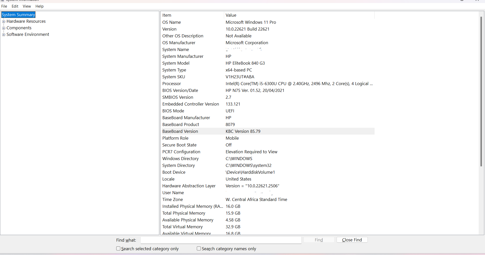
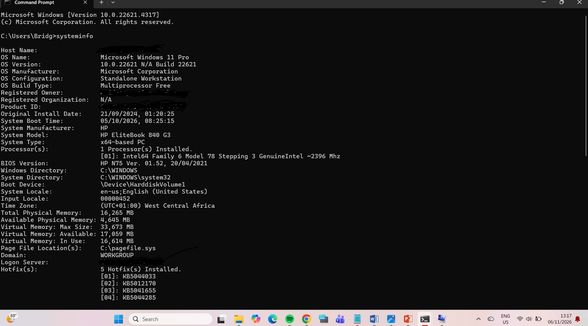
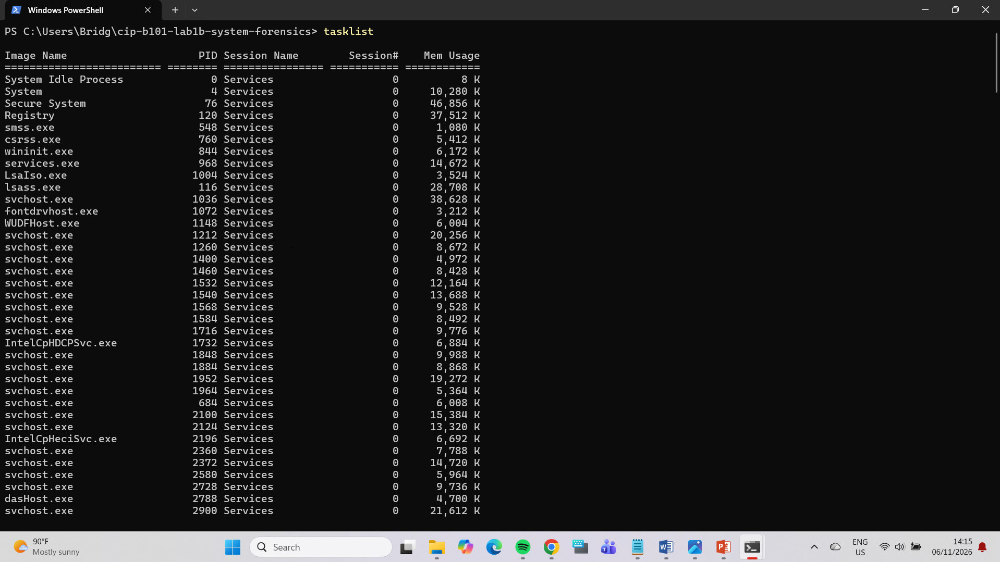
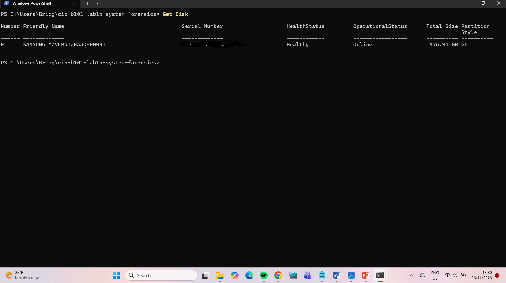
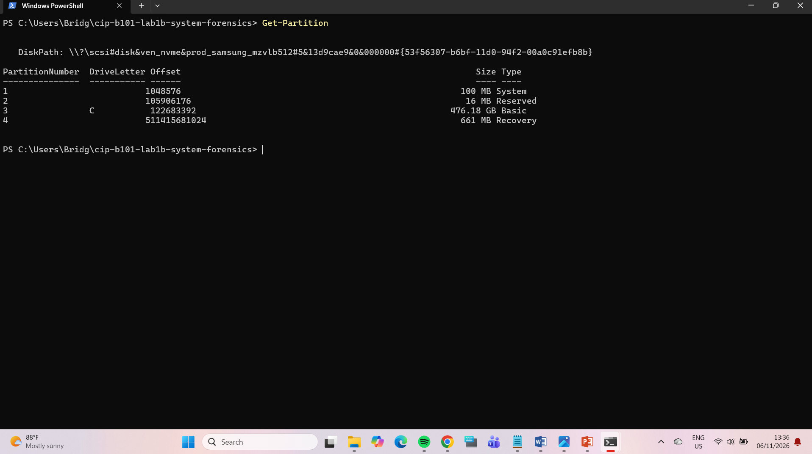
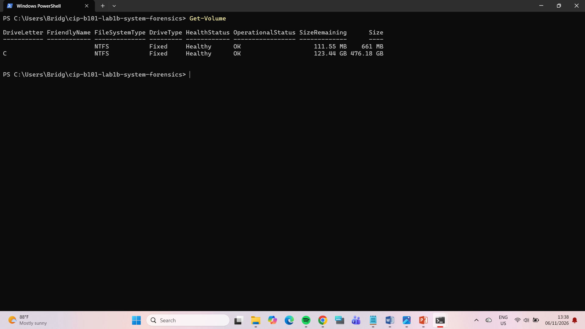
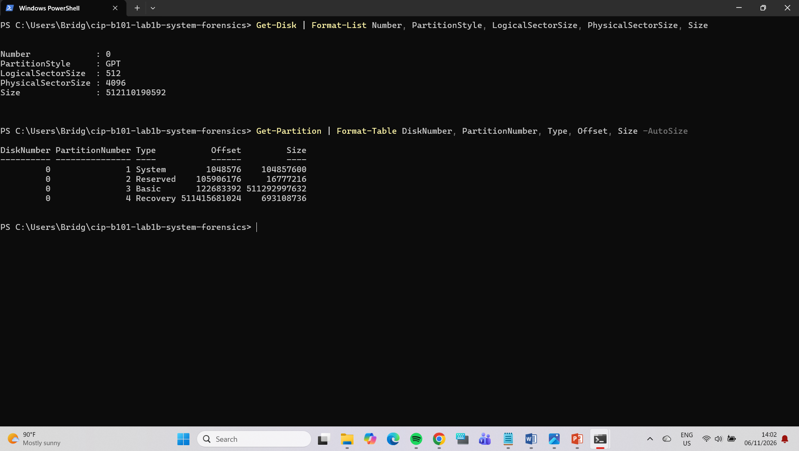
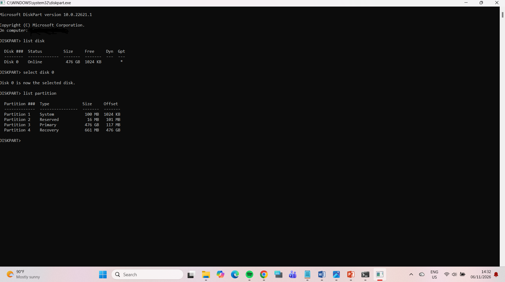
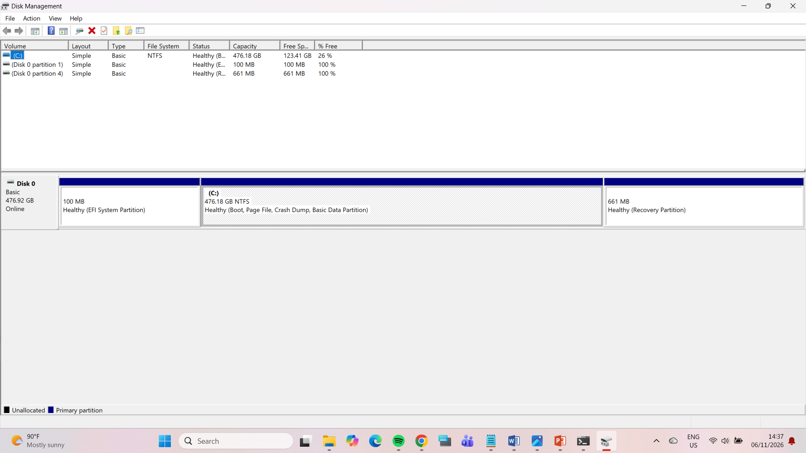

# Lab 1B: PC System Fundamentals, Disk Sectors and Partition Analysis

| | |
|---|---|
| **Name** | Bridget Yisa |
| **Registration No.** | C11/26/PCDFIR/17009 |
| **Course Code** | CIP-B101 |
| **Course Title** | Basic Computer Skills for Digital Forensics |
| **Lab Code** | Lab 1B |
| **Lab Title** | PC System Fundamentals, Disk Sectors and Partition Analysis |
| **Date** | 6 November 2026 |
| **Instructor** | Basiru Aliyu |

---

## 1. Introduction

This lab builds an initial system profile of a Windows computer, the way a junior forensic trainee would before an investigation. The aim is to observe, record, calculate and verify, without changing anything on the machine. I collected system specifications, storage and partition details, a process list and file system information using read-only commands. I then calculated partition sizes from sector counts and checked them against what Windows reports. Every command used was read-only. No disk was formatted, resized, cleaned or modified.

## 2. Tools Used

- Windows 11 Pro (personal computer, HP EliteBook 840 G3)
- System Information (`msinfo32`) and `systeminfo`
- PowerShell: `Get-Disk`, `Get-Partition`, `Get-Volume`
- Command Prompt: `tasklist`
- DiskPart (listing commands only: `list disk`, `select disk 0`, `list partition`)
- Disk Management (`diskmgmt.msc`)
- Windows Snipping Tool for screenshots
- Git and GitHub for submission

## 3. System Specification Evidence

| Item | Value |
|---|---|
| System model | HP EliteBook 840 G3 (HP) |
| OS Name | Microsoft Windows 11 Pro |
| Version | 10.0.22621 Build 22621 |
| System Type | x64-based PC |
| Processor | Intel(R) Core(TM) i5-6300U @ 2.40 GHz, 2 cores, 4 logical processors |
| Installed Physical Memory (RAM) | 16.0 GB (15.9 GB usable) |
| BIOS Version/Date | HP N75 Ver. 01.52, 20/04/2021 |
| **BIOS Mode** | **UEFI** |
| Secure Boot State | Off |

**Observations:**
- msinfo32 shows BIOS Mode: UEFI, so this system boots using UEFI firmware rather than legacy BIOS. This matches the GPT partition style found in Section 7.
- Secure Boot State is **Off**, even though the firmware is UEFI. Secure Boot is a UEFI feature that only allows trusted, signed boot software to load. With it off, the boot chain is not being verified. An examiner would note this, since unsigned boot code could run on this machine.
- `systeminfo` reports the same OS, model and BIOS version as msinfo32 and shows 16,265 MB of physical memory, which is consistent with the 16 GB of RAM.
- The capture date is 6 November 2026 (06/11/2026 in the day/month format used by `systeminfo`).

## 4. Evidence Layer Mapping (A3)

| Layer / Source | Example Evidence | Where It May Be Found | Why It Matters |
|---|---|---|---|
| User layer | Opened files, search terms, usernames | Recent files, browser history, shell history | Links a person's actions to system activity |
| Application layer | Browser cache, document metadata, chat logs | Application folders and databases | Shows what software created or used the data |
| OS layer | Event logs, installed programs, user profiles | Windows event logs, registry | Shows system events and account activity |
| Disk layer | Deleted files, fragments, partitions | File system and unallocated space | Supports recovery and timeline analysis |
| Memory / process layer | Running malware, PIDs, network connections | RAM capture, process list | Shows live system behaviour that disappears at shutdown |
| Firmware / boot layer | Boot configuration, boot records | UEFI settings, EFI System Partition | Can reveal tampering or multi-boot setups |

**Why evidence exists in more than one layer:** one user action touches several layers. For example, downloading a file leaves a browser history entry (application), a registry or event log trace (OS), the file and its timestamps on disk (file system), and possibly data in RAM while it is open. If one trace is deleted, the others can still support the finding.

## 5. Process Observation (B1)

| Process | PID | Likely purpose |
|---|---|---|
| `System` | 4 | The Windows kernel process. Runs core OS tasks and kernel-mode drivers. |
| `lsass.exe` | 116 | Local Security Authority Subsystem. Handles logins, password verification and security policy. |
| `svchost.exe` | 1036 | A generic host process that runs Windows services. Many copies run at once. |

*PIDs are valid only for this capture (6 November 2026) and change after a reboot.*

## 6. Program vs Process vs Thread (B2)

- **Program:** a passive file on disk containing instructions, for example `notepad.exe`. It does nothing until it is run.
- **Process:** a running instance of a program. It has its own memory space, a PID and resources. The same program can have several processes.
- **Thread:** the smallest unit of execution inside a process. A process has at least one thread, and its threads share the process's memory.

**Forensic relevance:** in live triage and malware analysis, the process list shows what is running right now. Analysts look for odd names, processes running from unusual paths, wrong parent processes (for example `svchost.exe` not started by `services.exe`), and unexpected network connections. `lsass.exe` is watched closely because credential-stealing malware targets it. Process data lives in RAM and is lost at shutdown, so it must be captured live.

## 7. Disk and Partition Inspection

**Disk summary (Disk 0):**

| Property | Value |
|---|---|
| Partition style | **GPT** |
| Logical sector size | 512 bytes |
| Physical sector size | 4096 bytes (a "512e" drive) |
| Total size | 512,110,190,592 bytes |

**Partition table (from `Get-Partition`):**

| # | Type | Offset (bytes) | Size (bytes) |
|---|---|---|---|
| 1 | System (EFI) | 1,048,576 | 104,857,600 |
| 2 | Reserved (MSR) | 105,906,176 | 16,777,216 |
| 3 | Basic (C:) | 122,683,392 | 511,292,997,632 |
| 4 | Recovery | 511,415,681,024 | 693,108,736 |

Start sector = Offset ÷ 512. Sector count = Size ÷ 512. End sector = Start + Sectors − 1.

| # | Start sector | Sector count | End sector |
|---|---|---|---|
| 1 | 2,048 | 204,800 | 206,847 |
| 2 | 206,848 | 32,768 | 239,615 |
| 3 | 239,616 | 998,619,136 | 998,858,751 |
| 4 | 998,858,752 | 1,353,728 | 1,000,212,479 |

Each partition starts on the sector right after the previous one ends, which confirms the table is consistent.

## 8. Manual Calculations

**Formula:** Size = number of sectors × bytes per sector. GB = bytes ÷ 1024 ÷ 1024 ÷ 1024.

### 8.1 Slide example (C1)

Sectors per track = 400, heads = 12, cylinders = 17000, bytes per sector = 512.

| Item | Calculation | Answer |
|---|---|---|
| Total sectors | 400 × 12 × 17,000 | 81,600,000 |
| Total bytes | 81,600,000 × 512 | 41,779,200,000 |
| Kilobytes | 41,779,200,000 ÷ 1024 | 40,800,000 KB |
| Megabytes | 40,800,000 ÷ 1024 | 39,843.75 MB |
| Gigabytes | 39,843.75 ÷ 1024 | **38.91 GB** |

### 8.2 Partition 1: EFI System Partition (Part G)

- Start sector = 1,048,576 ÷ 512 = 2,048
- Sector count = 104,857,600 ÷ 512 = 204,800
- Bytes = 204,800 × 512 = 104,857,600
- GB = 104,857,600 ÷ 1024³ = **0.0977 GB** (exactly 100 MiB)

### 8.3 Partition 2: Microsoft Reserved Partition (Part G)

- Start sector = 105,906,176 ÷ 512 = 206,848
- Sector count = 16,777,216 ÷ 512 = 32,768
- Bytes = 32,768 × 512 = 16,777,216
- GB = 16,777,216 ÷ 1024³ = **0.0156 GB** (exactly 16 MiB)

### 8.4 Extra: Partition 3 (C:) and Partition 4 (Recovery)

**Partition 3**
- Start sector = 122,683,392 ÷ 512 = 239,616
- Sector count = 511,292,997,632 ÷ 512 = 998,619,136
- GB = 511,292,997,632 ÷ 1024³ = **476.18 GB**

**Partition 4**
- Start sector = 511,415,681,024 ÷ 512 = 998,858,752
- Sector count = 693,108,736 ÷ 512 = 1,353,728
- GB = 693,108,736 ÷ 1024³ = **0.6455 GB**

### 8.5 Whole disk

- Sectors = 512,110,190,592 ÷ 512 = 1,000,215,216
- GB = 512,110,190,592 ÷ 1024³ = **476.94 GB**

### 8.6 Comparison with OS-reported size

| Partition | Partition table size (bytes) | `Get-Volume` size (bytes) | Difference |
|---|---|---|---|
| 1 (EFI) | 104,857,600 | Not listed by `Get-Volume` | DiskPart and Disk Management both show 100 MB, which matches 104,857,600 bytes (exactly 100 MiB) |
| 2 (MSR) | 16,777,216 | No file system, so no volume | DiskPart shows 16 MB, which matches 16,777,216 bytes (exactly 16 MiB). Disk Management does not list it |
| 3 (C:) | 511,292,997,632 | 511,292,993,536 | 4,096 |
| 4 (Recovery) | 693,108,736 | 693,104,640 | 4,096 |

**C: usage (from `Get-Volume`):**
- Used = 511,292,993,536 − 132,503,343,104 = 378,789,650,432 bytes = 352.78 GB
- Free = 132,503,343,104 bytes = 123.40 GB

### 8.7 Explanation of differences

1. **Partition vs volume:** the NTFS volumes are 4,096 bytes smaller than their partitions, which is a small amount of file system overhead (one 4 KiB cluster).
2. **GB vs GiB:** the drive is sold as 512 GB (units of 1000³), but Windows divides by 1024³, so 512,110,190,592 bytes shows as 476.94 GB. No space is missing, only the unit differs.
3. **Rounding:** DiskPart and Disk Management round to whole MB or GB, while these calculations use exact byte counts.
4. **Hidden partitions:** Disk Management does not show the 16 MB Reserved partition (screenshot 09), but DiskPart does (screenshot 08). This also explains a small gap in the disk size: Disk Management reports Disk 0 as 476.92 GB, while the exact size from `Get-Disk` is 476.94 GB. The difference is 0.0156 GB, which is the hidden 16 MB Reserved partition. Check: (104,857,600 + 511,292,997,632 + 693,108,736) ÷ 1024³ = 476.92 GB.

## 9. Boot Process (E1)

1. **Power-on:** power reaches the hardware and the CPU starts running firmware code.
2. **POST (Power-On Self Test):** the firmware checks that the CPU, memory and basic devices work.
3. **UEFI firmware:** reads its settings (stored in CMOS/NVRAM), such as boot order and Secure Boot.
4. **Boot record:** on a GPT disk, UEFI reads the GPT and finds the EFI System Partition (partition 1 here) and its boot entry. A legacy BIOS system would use the MBR instead.
5. **Boot manager / loader:** the Windows Boot Manager runs and loads the operating system loader. This is also where a multi-boot menu would appear.
6. **Kernel loading:** the OS kernel and core drivers are loaded into memory.
7. **OS control:** system services and the login screen start. Logs and user activity begin to accumulate.

**This system:** msinfo32 shows BIOS Mode: **UEFI**, and `Get-Disk` shows **GPT**, so it uses UEFI boot with an EFI System Partition.

## 10. MBR vs GPT (E2)

| Feature | MBR | GPT |
|---|---|---|
| Age / design | Older scheme from the 1980s, used with legacy BIOS | Modern scheme, used with UEFI |
| Size limit | About 2 TB per disk | Very large disks (about 9.4 ZB) |
| Partition info | Partition table in sector 0 together with boot code | Primary and backup GPT headers and partition entries |
| Forensic issue | Damage to sector 0 affects partition interpretation | The backup copy helps validation and recovery |

My disk uses GPT (confirmed by `Get-Disk`, screenshot 03). GPT disks normally also carry a protective MBR at sector 0 and a backup GPT at the end of the disk. I did not open the raw sectors in a hex viewer (the optional step D3), so I have not verified those structures directly.

## 11. File System Identification (F)

From `Get-Volume` (screenshot 05):

| Volume | File system | Notes |
|---|---|---|
| C: (partition 3) | NTFS | Main Windows volume |
| Recovery (partition 4) | NTFS | Windows Recovery Environment |

The EFI System Partition is normally FAT32. The `Get-Volume` output did not list it, so I could not confirm that from my evidence.

**Why file systems matter in digital forensics:** the file system decides how files are stored, named and tracked. NTFS keeps rich metadata, including MFT entries, timestamps, permissions and a journal. These support timeline analysis, deleted-file recovery and showing when a file was created, changed or accessed. Different file systems (FAT, ext, XFS, btrfs, HFS+) store this differently, so an examiner must identify the file system before choosing how to analyse it.

## 12. Conclusion

I profiled a UEFI/GPT Windows system using read-only tools only. I identified four partitions (EFI, Reserved, C:, Recovery), converted their offsets and sizes to sector counts, and calculated sizes in GB. The results match what Windows reports, apart from a 4,096-byte NTFS overhead and the GB/GiB unit difference. This matters in digital forensics because evidence sits in many layers, because partition and file system structures determine where data can be found, and because every step must be done without altering the original system and be documented so it can be repeated.

## Appendix

Evidence files are in the `screenshots/` folder:

| File | Content |
|---|---|
| `01_msinfo32.png` | System Information |
| `02_systeminfo.png` | `systeminfo` output |
| `03_get-disk.png` | `Get-Disk` |
| `04_get-partition.png` | `Get-Partition` |
| `05_get-volume.png` | `Get-Volume` |
| `06_sector-info.png` | GPT, sector sizes, offsets |
| `07_tasklist.png` | `tasklist` |
| `08_diskpart.png` | DiskPart listing |
| `09_diskmgmt.png` | Disk Management |
